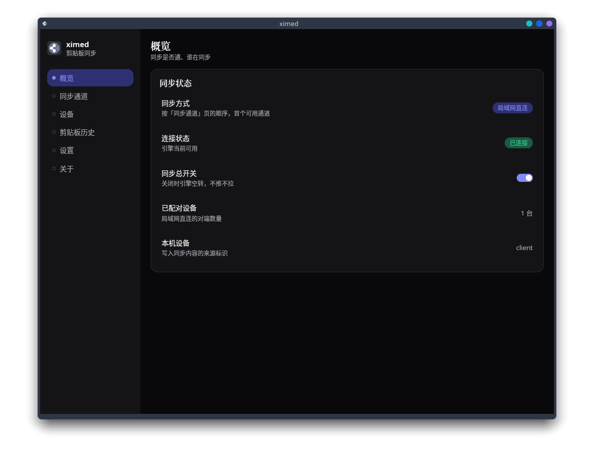
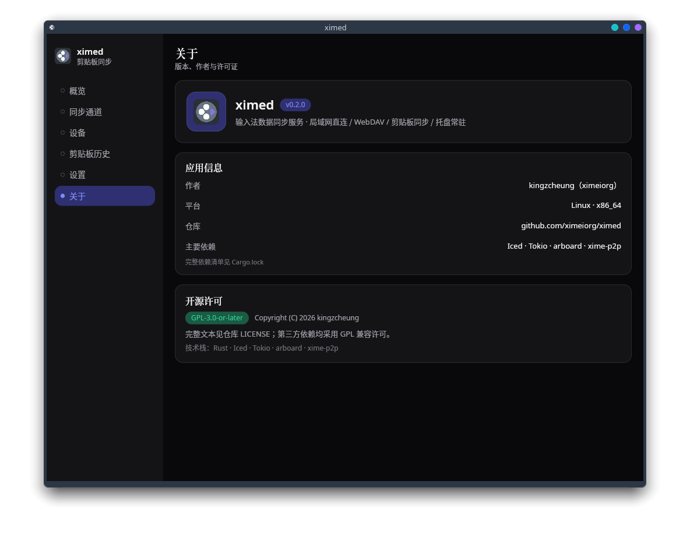

# ximed

面向输入法的数据同步服务：在设备之间同步剪贴板内容。Rust 实现，桌面端带 iced UI 与系统托盘。

> **当前支持范围**：桌面形态的局域网直连（P2P）与 WebDAV。内置 HTTP 通道与独立 server 形态已从界面隐藏，当前版本暂不支持；相关代码保留在仓库，后续版本再开放。

<p align="center">
  
</p>

## 功能

- **两种同步方式**：局域网直连（P2P）与 WebDAV。
- **剪贴板同步**：文本与图片双向同步，可分别控制上传/下载与内容类型。
- **剪贴板历史**：本地保留最近记录，随时回看、复制。
- **设备配对**：局域网设备用 6 位码配对，建立信任后直连，无需第三方服务器。
- **系统托盘常驻**：Windows / Linux / macOS 关窗不退出，从托盘恢复窗口或退出。
- **低占用**：单进程桌面形态，Rust 实现，资源占用低。
- **跨平台**：Windows / Linux / macOS 同一套代码，CI 构建三平台桌面安装包。

## 形态

| 二进制 | 定位 | 当前状态 |
| --- | --- | --- |
| `ximed-desktop` | 桌面形态：UI + 托盘 + 同步引擎 | 支持 |
| `ximed-client` | 客户端形态：连接远端 server | 依赖 server，暂不提供支持 |
| `ximed-server` | 纯服务端：无 GUI | 暂不支持（代码保留） |

## 快速开始

要求 Rust stable（edition 2024，Rust 1.85+）。

```bash
git clone https://github.com/ximeiorg/ximed.git
cd ximed

# 桌面形态
cargo run --bin ximed-desktop
```

Linux 桌面构建需要 GTK3 / AppIndicator 与 X11/Wayland 开发头文件，Ubuntu/Debian 可参考：

```bash
sudo apt install pkg-config libgtk-3-dev libayatana-appindicator3-dev \
  libx11-dev libxi-dev libxrandr-dev libxkbcommon-dev libwayland-dev \
  libgl1-mesa-dev libegl1-mesa-dev
```

Windows 需要 MSVC 工具链（exe 图标由 `embed-resource` 嵌入）；macOS 需要 Xcode Command Line Tools。完整矩阵见 `.github/workflows/build-packages.yml`。

> 独立 server 形态当前暂不支持，不提供构建/部署说明。

## 配置

桌面形态的界面设置保存在配置目录下的 `ximed-client.toml`，同步通道、配对与历史都在界面里完成；默认数据目录是 `./data`，在「设置」页可以看到并打开。


## 项目结构

```text
crates/app      三个二进制入口 + iced UI + 系统托盘
crates/client   同步引擎、传输通道（P2P / WebDAV）、剪贴板、历史
```

同步协议与领域类型复用 libximecore / libximep2p 的上游 crate（具体 rev 由 Cargo.lock 锁定）。本地开发时 `.cargo/config.toml` 可把这两个仓库 patch 到同级目录；CI 与发布构建使用 git 依赖。

## 关于页

<p align="center">
  
</p>

## 开发

```bash
cargo fmt --all
cargo check --workspace
cargo check --workspace --no-default-features
cargo test --workspace
```

提交需遵循仓库约定：一个功能点一次提交、commit 必须 GPG 签名。当前测试 72 项（client 54 + app 18）。

## 状态与路线图

- [x] 局域网直连（P2P）与 WebDAV 两种原生通道
- [x] 剪贴板文本/图片同步、历史、设备配对
- [x] 三平台托盘常驻与显示/隐藏/退出
- [ ] 恢复内置 HTTP 通道与独立 server 形态
- [ ] 文件同步（跨平台剪贴板文件路径读写）
- [ ] 三平台开机自启
- [ ] macOS `.app` 打包（LSUIElement + 图标）
- [ ] GNOME 无 AppIndicator 扩展时的托盘回退

## 许可证

本项目以 **GNU General Public License v3.0 or later** 发布，完整文本见 [LICENSE](LICENSE)。

桌面版默认链入 GPL-3.0-or-later 的 `xime-p2p` / `xime-sync-domain`；其余第三方依赖使用 MIT / Apache-2.0 / Zlib 等 GPL 兼容许可。主要依赖可在应用「关于」页查看，完整依赖清单见 `Cargo.lock`。

## 作者

- kingzcheung（ximeiorg）
- 仓库：<https://github.com/ximeiorg/ximed>
